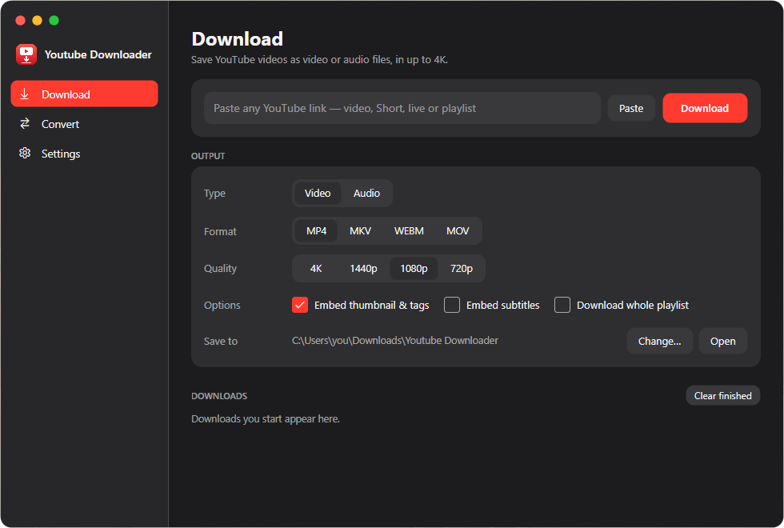
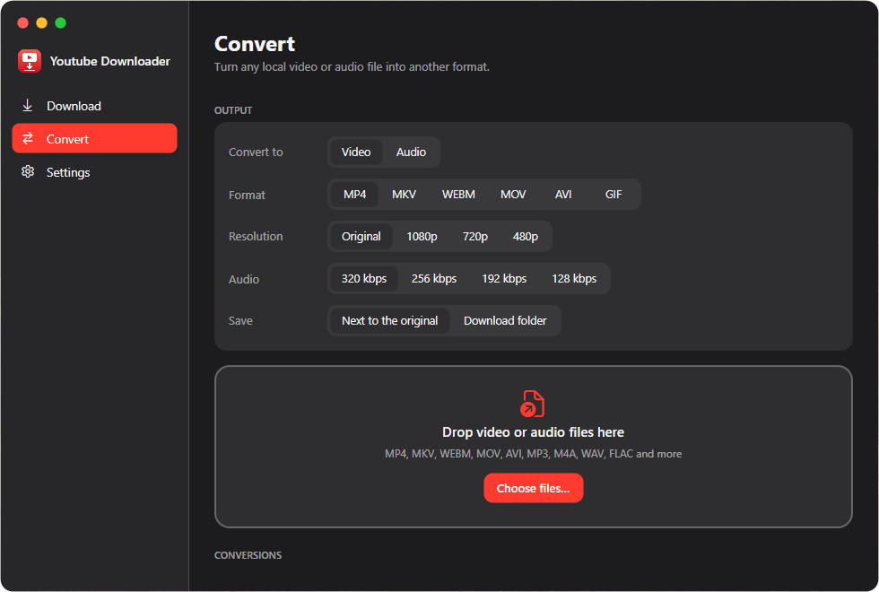
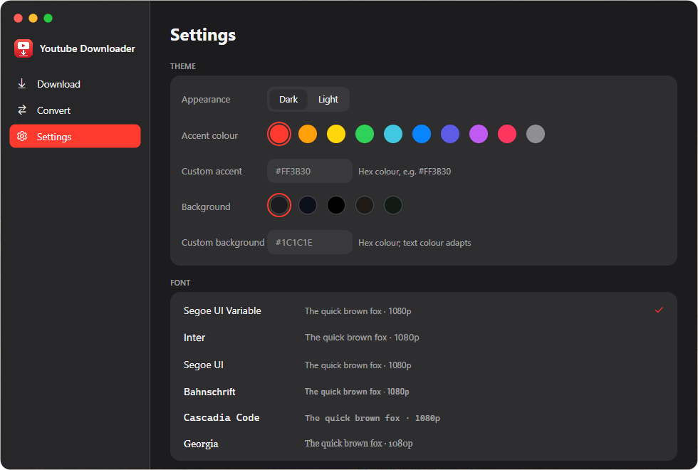

<p align="center">
  
</p>

<h1 align="center">Youtube Downloader</h1>

<p align="center">
  A clean, macOS-inspired YouTube downloader and media converter for Windows.<br>
  Paste a link, pick a format and quality, and you're done.
</p>

<p align="center">
  <a href="../../releases/latest"><b>⬇ Download the latest release</b></a>
</p>

<p align="center">
  
</p>

## Features

**Download from YouTube**
- Works with any YouTube link: videos, Shorts, livestreams, YouTube Music and whole playlists
- **Video:** MP4, MKV, WEBM or MOV in **4K, 1440p, 1080p or 720p**. If a video isn't available in that quality, you get the best one below it.
- **Audio:** MP3, M4A or OPUS at 128–320 kbps, or lossless WAV and FLAC
- Shows a preview of the title, channel, length and best available quality before you download
- Can embed the thumbnail, tags and subtitles
- Runs several downloads at once, and each one can be cancelled, retried or opened in Explorer
- Picks up a YouTube link from your clipboard when you switch to the app

**Convert local files**
- Drag and drop any video or audio file, or several at once
- Convert to MP4, MKV, WEBM, MOV, AVI, GIF, MP3, M4A, WAV, FLAC, OPUS, OGG or AAC
- Can shrink videos to 1080p, 720p or 480p, and lets you choose the audio bitrate

**Made to look good**
- Borderless window with rounded corners and red, yellow and green window buttons
- Dark and light mode, 10 accent colours or your own hex colour, plus background presets
- Six fonts to choose from: Segoe UI Variable, Inter, Segoe UI, Bahnschrift, Cascadia Code and Georgia

<p align="center">
  
  
</p>

## Install

Download one of these from the [latest release](../../releases/latest):

| File | What it is |
| --- | --- |
| `YoutubeDownloaderSetup.exe` | Installer. Installs for your user only (no admin rights) and adds a Start Menu entry and an optional desktop shortcut. Uninstall it from Windows Settings › Apps. |
| `YoutubeDownloader.exe` | Portable version. Just run it. |

Both are self-contained, so you don't need .NET installed. Requires Windows 10 or 11 (64-bit).

> Windows SmartScreen may warn you because the app isn't code-signed. Click **More info › Run anyway**.

On first start the app downloads [yt-dlp](https://github.com/yt-dlp/yt-dlp) and [FFmpeg](https://ffmpeg.org), unless they're already on your PATH, and stores them in `%LOCALAPPDATA%\YoutubeDownloader\tools`. YouTube changes often, so if downloads stop working, click **Settings › Update yt-dlp**.

## Build from source

You need the [.NET 10 SDK](https://dotnet.microsoft.com/download).

```bash
dotnet run -c Release
```

To build the portable exe and the installer into `publish\`:

```bash
powershell -ExecutionPolicy Bypass -File scripts/build.ps1
```

| Folder | Contents |
| --- | --- |
| `Source/` | C# and Avalonia UI code |
| `Assets/` | App icon |
| `scripts/` | Build script, and the script that draws the icon (`make-icon.ps1`) |
| `docs/` | Screenshots |

Built with [Avalonia UI](https://avaloniaui.net). Downloading is done by [yt-dlp](https://github.com/yt-dlp/yt-dlp), and merging and converting by [FFmpeg](https://ffmpeg.org).

## Disclaimer

This project isn't affiliated with YouTube or Google. Only download content you own or have permission to download, and follow YouTube's Terms of Service and the copyright laws where you live.
